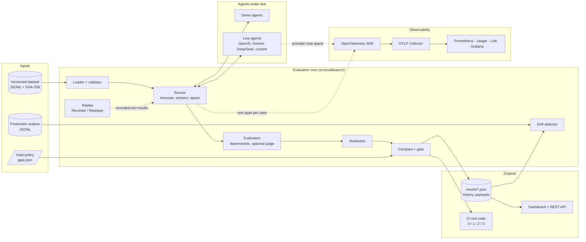
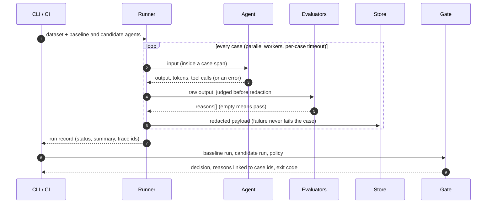

<p align="center">
  
</p>

<h1 align="center">EvalBeacon</h1>

**Release gates for LLM and agent changes.** Run the same versioned dataset against a baseline and a candidate, compare quality, errors, latency and cost, and fail CI with a clear reason when a threshold is breached. Built on OpenTelemetry so every evaluated case links to a trace.

[](pyproject.toml)
[](https://opentelemetry.io/)
[](#license)

**Live demo:** [evalbeacon.vercel.app](https://evalbeacon.vercel.app)
---

## Contents

[Why](#why) · [Features](#features) · [Architecture](#architecture) · [Quickstart](#quickstart) · [Live check](#live-check-with-your-own-key) · [CLI](#cli) · [Dashboard and API](#dashboard-and-api) · [Datasets and evaluators](#datasets-and-evaluators) · [Gate policy](#gate-policy) · [Output contracts](#output-contracts) · [Providers and configuration](#providers-and-configuration) · [Optional extensions](#optional-extensions) · [Observability stack](#observability-stack) · [CI](#ci) · [Security](#security) · [Benchmark](#benchmark) · [Status and limitations](#status-and-limitations) · [Troubleshooting](#troubleshooting) · [Project layout](#project-layout) · [License](#license)

## Why

Changing a prompt, model or agent workflow can silently make answers worse, slower or more expensive. EvalBeacon answers four questions with evidence:

- Did quality regress, and on which cases?
- Did failures, latency or cost move past a threshold?
- Can the failure be reproduced from the same dataset and settings?
- Should this candidate ship? The answer is an exit code a CI job can act on.

## Features

- **Versioned datasets:** JSONL cases with stable IDs and a content-hash version, validated with line-numbered errors.
- **Deterministic evaluators:** `exact`, `must_contain`, `must_not_contain`, `regex`, `json_fields`, `tool_calls`, `error_contains` (expected-error behaviour) and `similar_to`.
- **Runner:** per-case timeouts, parallel workers, stable result order. A failing agent becomes a failed case, never a crashed run.
- **Baseline vs candidate gate:** pass rate, error rate, regressions, p50/p95 latency, tokens and cost, with a policy file and CI-friendly exit codes.
- **Honest cost accounting:** provider-reported usage times a versioned price table. Missing usage is `null`, never `0`, and the cost gate says so when it is skipped.
- **Traces:** one OpenTelemetry span per case; the `trace_id` is stored in the result.
- **Safe execution:** hung agents cannot block a run or CI; optional process isolation really terminates them; the runner never retries a case.
- **Live check:** choose OpenAI, Gemini, DeepSeek or Anthropic, paste a key, and get a real gate verdict from the dashboard.
- **Machine-readable contract:** a JSON Schema for every report, validated in CI.
- **Safe payloads:** redaction before anything reaches results, spans, the API or the UI; full payloads go to a pluggable store (local or S3), not onto spans.
- **Optional extensions:** LLM judge, production-vs-golden drift signal, replay with mocked tools, run history with retention, additional providers.
- **Dashboard:** a single-page UI over the JSON contract, with light and dark themes.

## Architecture

EvalBeacon is a thin evaluation layer over an OpenTelemetry-instrumented LLM stack. The evaluation core is pure Python with no database: inputs are JSONL files, outputs are JSON files, and every case carries a trace ID that links back to the telemetry pipeline.



### Request flow for one gate run



### Components

| Layer | Component | Responsibility | Failure behaviour |
|---|---|---|---|
| Input | `load_dataset` | Validate JSONL, reject duplicates, derive content-hash version | Line-numbered `ValueError` (exit 2) |
| Execution | `run_eval` | Run cases in parallel, one span each, timeouts, cost, redaction | Errors and timeouts become `error` results; the run always completes |
| Judgement | `evaluate`, `judge_case` | Deterministic checks, then the optional LLM judge | A judge failure marks the case `error`; a judge never rescues a failed check |
| Safety | `redact`, `PayloadStore` | Scrub secrets before results, spans, API and storage | A store outage is recorded on the result, not raised |
| Decision | `compare`, `validate_policy` | Regressions, error rate, latency, cost against the policy | Broken baseline or mismatched versions give `error`; too few cases give `inconclusive` |
| Monitoring | `drift.detect` | Production-versus-golden similarity | Reports `stable`, `drift` or `inconclusive` |
| Reproduction | `Recorder`, `Replayer` | Re-run with recorded read-only tool results | Unrecorded calls raise `ReplayMissError`; side-effecting tools are refused |
| Persistence | `history`, JSON files | Idempotent save by `run_id`, count-based retention | Corrupt history files are skipped |
| Interfaces | `cli`, `api`, `ui` | Commands, REST endpoints, dashboard | Setup problems map to exit code 2 or HTTP 4xx |
| Telemetry | `LLMObservabilitySDK`, collectors | Traces, metrics and logs over OTLP | Usage-recording failures never corrupt the application response |

### Design decisions

- **Files, not a database.** Runs are small JSON documents keyed by `run_id`; a database is added only when a concrete need appears (concurrent writers, long retention, querying across runs).
- **Deterministic first.** Exact and rule-based evaluators decide pass or fail. The LLM judge and embedding similarity are opt-in signals that cannot override them.
- **Redact at the boundary.** Evaluators see raw output so redaction cannot change a verdict; everything that leaves the runner (results, spans, API, store, judge prompt) is redacted.
- **Unknown is not zero.** Missing usage yields `null` cost and a skipped cost gate, never a silent zero.
- **Setup errors are not regressions.** Provider failures and broken baselines exit 2, so CI can tell an outage from a quality drop.
- **One client for many providers.** OpenAI, Gemini, DeepSeek and any compatible endpoint share one instrumented client, so telemetry and cost handling are identical across them.

### Deployment topology

| Target | Contents | Notes |
|---|---|---|
| Local / CI | Full package, CLI, tests | `uv sync --extra dev`; no key needed for the demo |
| Docker | FastAPI app (`src/api/main.py`) plus the OpenTelemetry Collector, Prometheus, Grafana, Jaeger, Loki and Alertmanager defined in `docker-compose.yml` | App image verified (non-root); full telemetry stack not exercised end to end |
| Vercel | Slim bundle from `scripts/stage_vercel.py`: dashboard, eval API and sample data only (FastAPI plus the OpenTelemetry API and SDK) | Serverless filesystem is read-only, so nothing is persisted and history shows a labelled sample |

## Quickstart

Requires Python 3.11+ and [uv](https://docs.astral.sh/uv/). The demo and the tests need no API key.

```bash
uv sync --extra dev
uv run pytest                                      # offline, no keys: 257 tests (1 skipped: real-S3, opt-in)
uv run ruff check . && uv run mypy                 # lint and types
uv run evalbeacon demo --candidate candidate-bad   # degraded candidate  -> exit 1
uv run evalbeacon demo --candidate candidate-good  # healthy candidate   -> exit 0
uv run evalbeacon demo --candidate candidate-flaky # provider errors     -> exit 1 (error_rate)
uv run evalbeacon serve                            # dashboard: http://127.0.0.1:8000/ui
```

Results land in `results/` (`baseline.json`, `candidate.json`, `report.json`, `history/`).

Example gate output for the degraded candidate:

```
 GATE: FAIL
  ✗ [pass_rate]   pass rate fell 100% → 40% (max drop 5%)  cases: refund-001, shipping-001, ...
  ✗ [regressions] 6 case(s) passed in baseline but fail in candidate
  ✗ [cost]        cost +102% ($0.000215 → $0.000434)
```

## Live check with your own key

On the dashboard (`/ui`) open **Try with your key**, pick a provider, paste an API key and press **Run live check**. EvalBeacon sends one tiny request to prove the key works, then runs 10 cases against a *grounded* baseline and an *ungrounded* candidate with the provider's low-cost model and shows the same release-gate verdict as the CLI. **Load models from my key** replaces the dropdown with exactly the chat models that key can use right now (cheapest first), and **Custom model name…** accepts any other model.

| Provider | Default model (low cost) | Endpoint |
|---|---|---|
| OpenAI | `gpt-4o-mini` | `api.openai.com` |
| Gemini | `gemini-2.5-flash-lite` | Google's OpenAI-compatible endpoint |
| DeepSeek | `deepseek-flash` | `api.deepseek.com` |
| Anthropic | `claude-haiku-5-5` | Anthropic's OpenAI-SDK compatibility endpoint (a compatibility layer, not the full Messages API) |

How the key is handled (each point has a test in `tests/test_livecheck.py`): it travels only in the HTTPS request **body**, is held as a `SecretStr`, is used for this request only, and is never stored, logged, written to history or payload stores, put in a URL, or returned: the exact key string is scrubbed from the response even if a provider echoes it. The page clears the field before the request leaves. Validation errors do not echo the input. Only the four providers above and their fixed endpoints are reachable (no user-supplied URL), cases are capped at 10, there are no retries, and a per-client rate limit applies (best effort: serverless instances do not share memory). Provider failures become fixed, safe messages (`invalid_key`, `no_credit`, `quota_exceeded`, `rate_limited`, `model_not_found`, `unreachable`); provider error text is never forwarded. The key still passes through the server you run it on, so use a key you can revoke, and only use a deployment you trust.

## CLI

| Command | Purpose |
|---|---|
| `evalbeacon demo [--candidate candidate-bad\|candidate-good\|candidate-flaky]` | Offline baseline vs candidate with the bundled demo agents |
| `evalbeacon live --provider openai\|gemini\|deepseek\|anthropic\|custom [--model M] [--judge-provider P] [--max-retries N]` | Same comparison against a real model (grounded baseline vs ungrounded candidate); reads keys from `.env` |
| `evalbeacon compare BASELINE.json CANDIDATE.json [--policy P]` | Gate two saved runs |
| `evalbeacon drift --current prod.jsonl [--golden RUN.json] [--threshold 0.6]` | Production-vs-golden drift signal |
| `evalbeacon replay [--record]` | Re-run with recorded tool results; never calls a live tool |
| `evalbeacon history` | List saved runs |
| `evalbeacon serve [--port 8000]` | Dashboard and API |

Common flags: `--dataset`, `--policy`, `--workers`, `--timeout`, `--keep N` (history retention), `--store` (save redacted payloads to `results/payloads`). Failing cases in the console summary are listed with their trace IDs.

**Exit codes:** `0` pass or stable · `1` gate failed or drift · `2` setup or usage error (bad key, bad policy, missing file, dataset mismatch, broken baseline) · `3` inconclusive (too few cases).

Helper scripts: `scripts/expect_exit.py` (assert an exact exit code, and say when a `2` is a setup error rather than a regression), `scripts/validate_report.py` (schema check), `scripts/ci_summary.py` (Markdown job summary), `scripts/verify_stack.py` (end-to-end telemetry check), `scripts/bench.py`, `scripts/make_logo.py`.

## Dashboard and API

`/ui` shows the release verdict, the gate reasons, metric deltas, two interactive charts (pass rate by category, latency per case with p95 reference lines, hover tooltips and toggleable series), a filterable case table (failure reasons, redacted output, trace ID, judge verdict) and recent runs. Controls switch the scenario (degraded, healthy, flaky provider) and the dataset (10 or 28 cases), and the live-check panel runs a real provider.

| Endpoint | Description |
|---|---|
| `GET /api/v1/eval/report?candidate=candidate-bad&dataset=core` | Baseline, candidate and gate (`candidate`: `candidate-bad`, `candidate-good`, `candidate-flaky`; `dataset`: `core`, `extended`) |
| `POST /api/v1/eval/live-check` | Body `{provider, api_key, model?}`; runs the live check described above |
| `POST /api/v1/eval/models` | Body `{provider, api_key}`; the chat models that key can use, cheapest first |
| `GET /api/v1/eval/providers` | Supported live providers with default and suggested models |
| `GET /api/v1/eval/history?limit=20` | Saved runs; a labelled sample set when nothing is saved yet |
| `POST /api/v1/chat`, `POST /api/v1/rag/query` | Instrumented demo endpoints (full app only); validated bodies; provider failures return a sanitised 502 |
| `GET /health`, `GET /metrics`, `GET /docs` | Health, Prometheus metrics (full app only), OpenAPI |

Validation failures return 422 without echoing the rejected input.

## Datasets and evaluators

```json
{"id": "refund-001", "input": {"question": "Can I return an item after 30 days?"},
 "expected": {"must_contain": ["return policy"], "tool_calls": ["kb_search"]},
 "metadata": {"category": "policy"}}
```

Bundled datasets: `datasets/support.jsonl` (10 cases) and `datasets/support_extended.jsonl` (28 cases: 8 topics x 3 phrasings plus fallback cases), both sample customer-support datasets. The dataset version is a SHA-256 prefix of the file bytes, so any edit produces a new version and baseline and candidate must match.

| Key in `expected` | Passes when |
|---|---|
| `exact` | output equals the string (trimmed) |
| `must_contain` / `must_not_contain` | every / no listed term appears (case-insensitive) |
| `regex` | the pattern matches |
| `json_fields` | output is JSON containing every listed field |
| `tool_calls` | the agent's tool calls equal the list |
| `error_contains` | the agent raises an error containing the text (a case that expects a refusal) |
| `similar_to: {text, min}` | lexical cosine similarity to `text` is at least `min` (embeddings if you supply an embedder) |
| `judge: {rubric, min_score}` | optional LLM judge scores at least `min_score`; deterministic checks must also pass |

To evaluate your own agent, pass any `Callable[[dict], Output]` to `run_eval`.

## Gate policy

`configs/gate.json` (unknown keys and negative or non-numeric values are rejected with exit 2):

| Key | Default | Meaning |
|---|---|---|
| `min_cases` | 5 | below this the result is `inconclusive`, not a pass |
| `max_pass_rate_drop` | 0.05 | absolute drop versus baseline |
| `max_error_rate` | 0.10 | provider or runtime errors, kept separate from quality failures |
| `max_regressions` | 0 | cases that passed in baseline and fail in candidate |
| `max_p95_latency_increase_pct` | 50 | relative increase |
| `max_cost_increase_pct` | 25 | relative increase; skipped with a note when cost is unknown |

A baseline that itself errors above `max_error_rate` yields `error` (exit 2) with the first error, since comparing against a broken baseline says nothing about the candidate. Differing dataset or evaluator versions are also `error`. No statistical-significance claim is made; percentiles on small datasets are noisy.

## Output contracts

The contract is a JSON Schema: [`schemas/report.schema.json`](schemas/report.schema.json) (draft 2020-12; definitions `report`, `run`, `gate`, `drift`). Validate with `uv run python scripts/validate_report.py results/report.json`. Every run, gate and report carries `schema_version` (currently `1.0`); additive fields are minor bumps and readers must ignore unknown fields, while removing or retyping a field is a major bump. Unknown values are `null`, never `0`.

**Run** (`results/baseline.json`, `candidate.json`): `schema_version, run_id, name, status (complete|partial|failed), started_at, finished_at, config {model, revision, dataset_version, evaluator_version, pricing_version}, isolation {mode, timed_out_cases, still_running}, failure_summary[], summary, results[]`.

**Result:** `id, category, status (pass|fail|error), reasons[], output (redacted, or null), payload_ref, judge?, trace_id (32 hex or null), tokens_in, tokens_out, cost_usd (null = unknown), cost_basis, latency_ms`. `fail` means a check did not hold; `error` means the agent, provider or runner failed.

**Gate:** `schema_version, decision (pass|fail|error|inconclusive), exit_code, reasons[{gate, detail, cases[]}], regressions[], fixes[], policy, baseline, candidate, notes?`. The schema enforces that `decision` and `exit_code` agree and that `pass` carries no reasons.

**Span `evalbeacon.case`** (one per case): `evalbeacon.run`, `evalbeacon.case_id`, `evalbeacon.status`, `evalbeacon.latency_ms`, `gen_ai.request.model`, `gen_ai.usage.input_tokens`, `gen_ai.usage.output_tokens` and `llm.estimated_cost_usd` (the last three only when usage is known). Prompts and completions are never span attributes. Spans created by the agent nest under the case span. Provider calls made through the bundled client appear as `<provider> chat` spans; if recording usage fails the application still receives its response and the span gets `llm.telemetry_incomplete=true`.

**Cost basis:** measured tokens from the provider times the price table in `src/exporters/cost_estimator.py` (`PRICING_VERSION` is stored with every run). Prices are approximate and unverified. A model missing from the table is priced at the table's fallback and the result says so (`cost_basis` contains `FALLBACK`); a model with no reported usage has `cost_usd: null`.

## Providers and configuration

OpenAI, Gemini, DeepSeek and Anthropic share one OpenAI-compatible client (`src/collectors/providers.py`). Any other compatible endpoint (Ollama, vLLM, LiteLLM) works through `EVALBEACON_CUSTOM_BASE_URL`, `EVALBEACON_CUSTOM_API_KEY` and `EVALBEACON_CUSTOM_MODEL` (CLI only; custom endpoints are deliberately not reachable from the web live check).

**Models.** Defaults were checked against each provider's own model list: Gemini no longer serves any `gemini-2.0-*` model and DeepSeek now serves `deepseek-flash` and `deepseek-v4-pro`, so older names such as `gemini-2.0-flash-lite` and `deepseek-chat` are not used. Anthropic's ids could not be listed without a key. Model availability changes: use **Load models from my key** (or the provider's list) to see what an account can use. OpenAI's gpt-5.x and o-series are reasoning models, so the client sends `max_completion_tokens` (with room for hidden reasoning) and no `temperature` for them.

Copy `.env.example` to `.env` (git-ignored) and set only the keys you use:

| Variable | Required? | Purpose |
|---|---|---|
| `OPENAI_API_KEY`, `GEMINI_API_KEY`, `DEEPSEEK_API_KEY`, `ANTHROPIC_API_KEY` | only for CLI live runs and the demo chat/RAG endpoints | live provider access (names are matched case-insensitively). Not needed for tests, the demo, or the web live check (the user pastes a key) |
| `OTEL_EXPORTER_OTLP_ENDPOINT` | optional | collector endpoint; `http://localhost:4317` on the host, `http://otel-collector:4317` inside Docker Compose |
| `OTEL_SERVICE_NAME`, `ENVIRONMENT` | optional | resource attributes |
| `EVALBEACON_TRACE=console\|otlp` | optional | print case spans, or export them over OTLP/gRPC from the CLI |
| `EVALBEACON_CAPTURE_OUTPUT=0` | optional | store no model output at all |
| `EVALBEACON_REDACT_KEYS` | optional | extra field names to redact, e.g. `policy_number,member_ref` |
| `EVALBEACON_S3_TEST_BUCKET` | optional | enables the opt-in real-S3 integration test (a disposable bucket only) |

Tests and the demo never need a key. Never commit `.env`.

**Retry contract.** The runner never retries a case: each agent is called exactly once. The provider SDK client retries only transport failures (connection errors, 408/409/429/5xx) up to `--max-retries` times (default 1 for the CLI; 0 for the web check), each retry being the identical request; authentication errors are never retried. Tool side effects belong to agent code that runs after a response, so retries cannot duplicate them.

## Optional extensions

- **LLM judge** (`judge.py`): scores 1-5 against a rubric at temperature 0 on the *redacted* output; records judge model, version, cost and an uncertainty note. It is never the only check and cannot rescue a failed deterministic evaluator.
- **Similarity** (`similarity.py`): deterministic bag-of-words cosine by default; pass an embedder for semantic similarity (`live.make_embedder`).
- **Drift** (`drift.py`): per-case similarity of production outputs against a golden run, reported as `stable`, `drift` or `inconclusive`. A review signal, not proof of a quality change; the lexical default misses paraphrases.
- **Replay** (`replay.py`): `Recorder` captures read-only tool results into a cassette; `Replayer` serves them back and raises `ReplayMissError` for anything unrecorded. Tools flagged as side-effecting (refunds, emails, payments) are refused outright.
- **Payload store** (`store.py`): `LocalPayloadStore` and `S3PayloadStore` (lazy `boto3`); redaction happens inside `put()` and keys are sanitised against path traversal.
- **History** (`history.py`): runs saved by `run_id` (re-saving never duplicates) with count-based retention.

## Observability stack

The OpenTelemetry core is included (see [Architecture](#architecture)): `LLMObservabilitySDK` (traces, metrics, logs), the OpenAI-compatible and LangChain collectors, a Prometheus `/metrics` endpoint, and `configs/alerting_rules.yaml` (latency, error rate, token budget, cost anomalies, collector health). `scripts/load_test.py` generates sample traffic against the demo endpoints.

```
 app / agent ─▶ instrumentation ─▶ OTLP collector ─▶ traces → Jaeger · metrics → Prometheus · logs → Loki
      └─ eval runner (one span per case, trace_id in results) ─▶ gate ─▶ JSON + CI exit code
```

```bash
docker compose up -d --build
uv run python scripts/verify_stack.py     # runs an evaluation, then checks each backend
```

**Verified end to end** (11/11 checks on a clean start): an evaluation exported over OTLP reaches Jaeger and each case's stored `trace_id` finds its span, with the right status and an ERROR status for failed cases; Prometheus scrapes the app and the collector and loads the alert rules; metrics flow through the collector's exporter; the app's logs reach Loki with trace IDs attached; Alertmanager is ready; Grafana has Prometheus, Jaeger and Loki provisioned. With the collector stopped, an evaluation still finishes with the correct verdict and exit code; export errors are only logged.

Endpoints and local credentials: Jaeger http://localhost:16686 · Prometheus http://localhost:9090 · Alertmanager http://localhost:9093 · Loki http://localhost:3100 · **Grafana http://localhost:3000 (username `admin`, password `admin`, set by `GF_SECURITY_ADMIN_PASSWORD` in `docker-compose.yml`; change it before exposing the stack)**.

Defects found and fixed while verifying: the collector config was invalid for the pinned version (`loki` exporter `labels`), several mounted config files did not exist (Prometheus, Loki, Alertmanager, Grafana provisioning), the collector's healthcheck used a `wget` the image does not contain, host port 8889 is reserved on some Windows machines (it is now internal), and log records leaked provider error text into Loki. Not covered: the Grafana dashboards JSON the upstream README mentioned does not exist; Grafana ships with datasources only.

## CI

`.github/workflows/ci.yml` runs on push, pull request, nightly and manually. Job `checks`: locked install, `ruff`, `mypy`, `docker compose config`, the offline tests, then the release gates with **exact exit-code assertions** (`scripts/expect_exit.py`): healthy candidate must exit 0, degraded and flaky candidates must exit 1, a bad policy file must exit 2 (a setup error is never accepted as a regression), the report must match the JSON Schema, drift must be stable for the stable sample and detected for the drifted one, and record-and-replay must pass. A Markdown summary (with trace IDs) is always written to the job summary and the results are uploaded as an artifact, even on failure. Job `stack` (nightly and manual only) starts the Docker Compose stack and runs `scripts/verify_stack.py`.

Status: **verified on GitHub Actions** (see *Status and limitations*). The workflow's logic is also covered by `tests/test_ci_scripts.py`.

## Security

- Secrets live only in the environment or a git-ignored `.env`; they are never logged or written to results. The web live check never stores or echoes a pasted key (see above).
- Model output, error messages and **log records** (message, `extra` fields, tracebacks) are redacted before results, spans, the API, the UI, payload stores, the judge prompt and the OpenTelemetry log exporter. Evaluators judge the raw output, so redaction cannot flip a verdict. Patterns cover API keys (OpenAI/Anthropic/DeepSeek style, Google, AWS, GitHub), bearer and JWT tokens, `key=value` secrets, emails, SSNs and Luhn-valid card numbers; fields named like `password`, `api_key`, `token`, `customer_id`, `account_number`, `ssn` lose their whole value whatever the casing. Redaction is pattern-based, not a PII detector: add domain fields with `EVALBEACON_REDACT_KEYS` before using real customer data.
- Span attributes carry IDs, token counts and cost only; prompts and completions (including the RAG query, which is reduced to a length and a hash) are not attached to spans.
- API errors from providers are returned as a sanitised message (error class, HTTP status, error code); the raw text is only logged, redacted.
- Payload stores sanitise keys and validate refs, so neither writes nor reads can leave the store; `put()` redacts and never leaves partial files.
- The UI escapes all dynamic text. The Docker image runs as a non-root user.
- Use a least-privilege role for `S3PayloadStore` (tested against a fake client; the real-S3 test is opt-in). Rotate any key that has been pasted into a chat, ticket or log.

## Benchmark

`uv run python scripts/bench.py [--cases N] [--repeats N] [--otlp] [--json PATH]` runs a no-op agent so only the runner and tracing cost is measured, not model latency. Modes are **interleaved** within every repetition (and the order alternates) so machine drift hits each mode equally; warm-up runs are discarded; the overhead is the *paired* difference per repetition. CPU pinning was not used.

Measured on Python 3.13, Windows 11 AMD64, 8 CPUs, 4 workers, 500 cases per run:

| Run | Repetitions | Tracing off (median) | Tracing on, in-memory (median) | Paired overhead (median, IQR) | Repetitions where on > off |
|---|---|---|---|---|---|
| A | 15 | 0.200 ms/case | 0.283 ms/case | +0.072 ms (+0.057 to +0.098) | 14 / 15 |
| B | 30 | 0.194 ms/case | 0.263 ms/case | +0.067 ms (+0.059 to +0.076) | 30 / 30 |
| C (repeat of B) | 30 | 0.205 ms/case | 0.270 ms/case | +0.064 ms (+0.051 to +0.075) | 28 / 30 |
| D, OTLP gRPC exporter to a local collector | 20 | 0.205 ms/case | 0.352 ms/case | +0.142 ms (+0.123 to +0.158) | 20 / 20 |

So in-process tracing costs about 0.06 to 0.07 ms per case and a real OTLP exporter about 0.14 ms per case on this machine. These are single-machine numbers with a no-op agent: a real provider call takes hundreds of milliseconds, and no significance test was run. The earlier, non-interleaved script gave +0.050 to +0.069 ms, consistent with this.

## Status and limitations

| Area | Status |
|---|---|
| Telemetry contract, cost and payload safety, dataset and runner, gates, drift, replay, judge, history | Done and tested |
| Timeout isolation, cancellation, retry contract, concurrency | Done and tested (below) |
| Provider contracts (success, missing usage, rate limit, quota, auth, timeout, malformed body) | Tested with a mocked HTTP transport |
| Redaction in results, spans, API, stores, judge prompt and logs | Done and tested |
| JSON Schema for reports, validated in CI | Done and tested |
| Docker image and the full observability stack | Verified end to end (11/11 checks) |
| Live-check UI and API | Tested with simulated providers, plus the real OpenAI and Gemini error paths with fake keys; **a successful run against a real provider is not verified** |
| LLM judge, embedding similarity, S3 store | Implemented; tested with mocks and fakes only |
| GitHub Actions | Verified: the `checks` job passes on push (about 45 s) and the `stack` job passes when started manually |

**Timeouts.** By default each case runs on its own *daemon* thread: on timeout the case is recorded as an `error`, its late result is discarded, `evalbeacon.cancelled()` becomes true for cooperative agents, and the run continues. Python cannot kill a thread, so a timed-out agent may keep running in the background until it finishes (reported as `isolation.still_running`), but it can no longer block the process from exiting. `run_eval(..., isolation="process")` runs each case in a child process that is terminated on timeout, which really stops the work; it requires a picklable module-level agent and does not carry spans out of the child.

**Hosted CI evidence.** On branch `ci/hosted-run` of the GitHub repository: the push run passed all 19 steps of `checks` (lint, types, tests, exact exit-code gates, schema, drift, replay, summary, artifact), and the full `stack` job (Docker Compose, then `scripts/verify_stack.py`) passed when started with *Run workflow*. That job first failed on a clean runner (10/11): a freshly started app had logged nothing, so the Loki check had no data; the verifier now generates its own log event, and the app logs rejected requests. Two caveats: GitHub only runs *scheduled* workflows from the default branch, so the nightly run starts once this workflow is merged to `main`; and the `stack` job is skipped on ordinary pushes by design.

Known limits: results are JSON files, not a database; percentiles on small datasets are noisy; price tables are approximate; the bundled demo agents are simulated, not real models; on Vercel the filesystem is read-only so history shows a labelled sample; Anthropic is reached through its OpenAI-compatibility layer.

## Troubleshooting

| Symptom | Fix |
|---|---|
| `GATE: ERROR ... baseline_errors` | The baseline failed (bad key, no credit, rate limit); the first error is in the message. Fix setup and re-run |
| Live check says `no_credit` or `quota_exceeded` | The key is valid but the account has no credit, or the project's quota for that model is 0 (common on new Gemini projects): enable billing/quota or pick another model |
| Live check says `model_not_found` | That model name is retired or not available to the key. Use **Load models from my key** |
| `X_API_KEY is not set` | Add the key to `.env` (CLI), or paste it in the dashboard (web) |
| Exit code 3 / `inconclusive` | Fewer cases than `min_cases` |
| `unknown gate policy keys` | Typo in the policy file; valid keys are listed in the message |
| `dataset_mismatch` / `evaluator_mismatch` | Baseline and candidate came from different datasets or evaluator versions; re-run both |
| `trace_id` is null | No SDK tracer provider installed; use the CLI or configure OpenTelemetry first |
| `ReplayMissError` | The cassette lacks that call; `evalbeacon replay --record` |
| Cost is `null` or `cost_basis` says FALLBACK | The provider returned no usage, or the model is not in the price table |
| Garbled output or a crash printing symbols on Windows | Use the CLI (forces UTF-8) or set `PYTHONUTF8=1` |
| README or dashboard logo missing | The images are `assets/logo.png` and `assets/logo-64.png`; they must be committed with the README (`git add assets`) |
| `docker compose up` fails on port 8889 | Fixed: that port is no longer published to the host |

## Project layout

```
src/evalbeacon/   core, judge, similarity, redact, store, history, drift, replay, live, livecheck, demo, cli, api, ui/
src/collectors/   OpenTelemetry SDK, OpenAI-compatible collector, LangChain handler, providers
src/exporters/    cost estimator and price table
src/api/          FastAPI app (instrumented chat and RAG demo endpoints)
schemas/          report.schema.json (JSON Schema for every output)
datasets/         sample support datasets and production samples
configs/          gate policy, collector, Prometheus, Loki, Alertmanager, Grafana provisioning, alert rules
assets/           logo.png, logo-64.png (source artwork in assets/source/)
deploy/           slim Vercel entry point (dashboard, eval API and live check only)
scripts/          bench, verify_stack, expect_exit, ci_summary, validate_report, stage_vercel, make_logo, load_test
tests/            offline suite: unit, failure-path, API, CLI, schema, isolation, redaction, live check
```

Contributing: run `uv run ruff check . && uv run mypy && uv run pytest` before opening a pull request, and keep new behaviour covered by a test.

## License

MIT.
